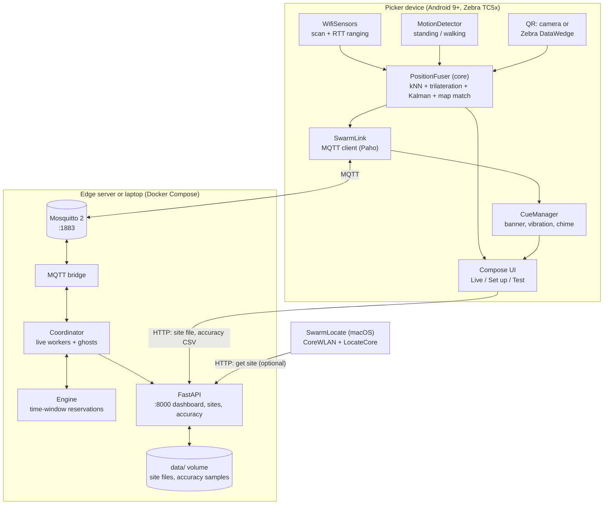
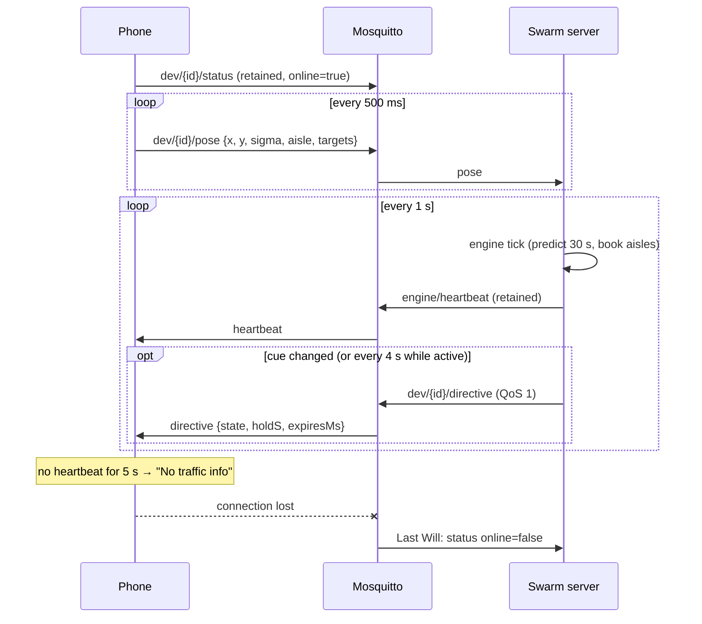

# System architecture

## Components

| Component | Technology | Role |
| --- | --- | --- |
| Android app | Kotlin, Jetpack Compose, Paho MQTT, ZXing | Positioning, cues, setup and accuracy test on the worker's device. |
| Core library | Pure Kotlin/JVM | All positioning maths and the message format. No Android imports, fully unit-tested. |
| Mac app | Swift, SwiftUI, CoreWLAN | Locates a MacBook from the phone's recordings. Own Swift port of the matcher. |
| Broker | Eclipse Mosquitto 2 | Low-latency publish/subscribe between devices and server. |
| Swarm server | Python 3.12, FastAPI, paho-mqtt | 1 Hz engine loop, ghost workers, site and accuracy storage, dashboard. |
| Dashboard | Static HTML + JS served by FastAPI | Live map of workers and cues, ghost count control. |

## Why MQTT (and not DDS)

The blueprint compared MQTT and DDS. MQTT was chosen because:

- A broker on one laptop is enough for 5 to 30 devices. Message rate is small (2 poses per
  second per device).
- MQTT works through normal Wi-Fi networks and NAT; DDS multicast discovery often does not
  work on enterprise Wi-Fi.
- MQTT has **Last Will** messages, **retained** messages and **QoS 1**, which map directly to
  the needs: online/offline status, latest heartbeat for new clients, and cues that must arrive.

## Data flow and timing

| Rate | Message |
| --- | --- |
| 10 Hz | Phone filter clock (Kalman predict) |
| Every 5 s (setting) | Wi-Fi scan. Needs scan throttling off, or Android allows only 4 scans per 2 minutes. |
| Every 500 ms | RTT ranging, when the phone supports it |
| 2 Hz | Pose to server |
| 1 Hz | Engine tick and heartbeat |
| Every 4 s | Re-send of an active cue, which refreshes its expiry |

## Failure handling

The system is designed so that every failure ends in a **safe, quiet state**.

| Failure | What happens |
| --- | --- |
| Phone loses Wi-Fi or the broker | Paho reconnects automatically. The broker publishes the phone's Last Will and the server removes the worker from planning (also after 10 s without a pose). The phone shows grey "No traffic info" after 5 s without heartbeat. |
| Server stops | No heartbeat: every phone falls back to "No traffic info". Cues already on screen expire after `expiresMs`. |
| Position is poor | The Kalman filter rejects outliers. The phone reports `sigma` (uncertainty) so the server can see it. A QR scan resets the position. |
| A worker ignores a cue | After 5 s the engine plans *around* that worker (gives them top priority) instead of insisting. |
| Old map on a phone | The heartbeat carries `siteVersion`; the phone can see its map is old. |

## Deployment options

| Option | When |
| --- | --- |
| **Laptop** on the same Wi-Fi | Demos and first floor tests. `docker compose up`. |
| **Small edge PC** (Intel NUC class, 4 cores, 8 GB) | Longer pilots. Same Compose file, `restart: unless-stopped`. |
| **On-prem server / VM** | Production-like tests. Put Mosquitto behind authentication and TLS first (the demo broker allows anonymous access). |
