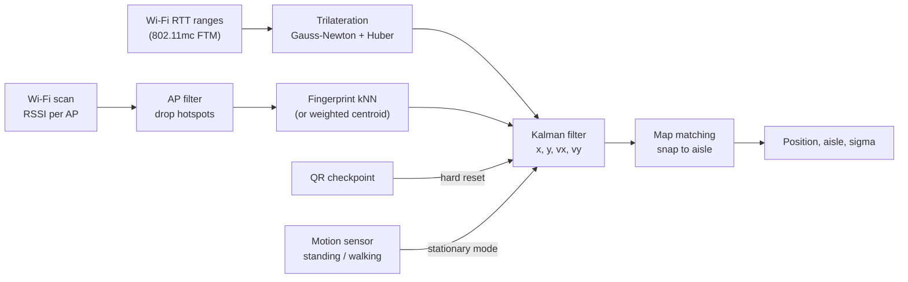

# Indoor positioning

GPS does not work indoors. The app uses the **Wi-Fi network that is already there**. It
combines four sources into one smooth position:

All of this is in the pure Kotlin `core` module
([`PositionFuser.kt`](https://github.com/rmaheedharan/swarm-amr/blob/main/core/src/main/kotlin/com/swarmamr/core/PositionFuser.kt)),
so it runs and is tested on any JVM.

## 1. Wi-Fi RTT (Fine Timing Measurement)

**What it is.** IEEE 802.11mc lets a phone measure the *round-trip time* of a radio frame to
an access point. Time of flight × speed of light ÷ 2 = distance. Android exposes it through
`WifiRttManager` from Android 9 (API 28), which is why the app needs API 28.

**When it works.** Both the phone and the access point must support 802.11mc FTM. Google
Pixel phones and newer Zebra devices often do. Many budget phones and many enterprise APs do
not. The app checks `FEATURE_WIFI_RTT` and shows the result in **Live > Traffic > Details**.

**How the position is solved.** With three or more ranges to APs at known positions, the app
solves weighted non-linear least squares with Gauss-Newton
([`Trilateration.kt`](https://github.com/rmaheedharan/swarm-amr/blob/main/core/src/main/kotlin/com/swarmamr/core/Trilateration.kt)):

- Each range is weighted by `1 / sigma²`, using the standard deviation Android reports, with a
  floor of 0.5 m.
- Ranges with fewer than 3 successful bursts, or a standard deviation above 2 m, are dropped.
- **Multipath and blocked line of sight** make RTT read too *long*, never too short. Large
  positive residuals are down-weighted with a **Huber loss** (k = 1.5 sigma), so one
  reflected path does not pull the fix.
- Each AP has an `rttBiasM` (constant offset) learned by **Calibrate distances at a marker**.
- APs in a straight line give no 2-D fix; the solver detects this (singular matrix) and returns nothing.

## 2. Wi-Fi fingerprinting (RSSI)

Works on **every** phone. The idea: each spot on the floor has a typical pattern of "which APs
I hear, and how loud".

**Recording (offline phase).** The user stands on a spot for 20 seconds while the app scans,
or walks a straight line (*walk and record*). For each AP the app stores the mean signal
(dBm) and its standard deviation. Turning around slowly once while recording captures the
effect of the user's own body.

**Matching (online phase)**
([`RssiPositioning.kt`](https://github.com/rmaheedharan/swarm-amr/blob/main/core/src/main/kotlin/com/swarmamr/core/RssiPositioning.kt)):

1. **Distance** between a live scan and each recording is a root-mean-square dB difference
   over all APs in either. A missing AP counts as −100 dBm. Each difference is clipped at
   20 dB, so one AP that appears or vanishes cannot dominate. APs that were unsteady while
   recording (std above 4 dB) count less. At least 3 shared APs are required.
2. **Neighbours.** Take the 3 best matches, keep only those within 3 dB of the best one, and
   weight them with a Gaussian kernel (1 dB). A plain average of k neighbours pulls positions
   at aisle ends toward the middle; the sharp kernel avoids that.
3. **Uncertainty** is the weighted spread of the neighbours, at least 1.2 m.
4. **Ambiguity.** If a recording at least 4 m away matches within 1.5 dB of the best, the app
   says *Near A or B*. The setup screen also lists **look-alike** spots so the user can add
   recordings between them.
5. **Standing still.** When the motion sensor says the user is still, the last 4 scans are
   averaged before matching. One scan is noisy; four are much steadier.

**Fallback.** Before any recordings exist, a **weighted centroid** of the strongest known APs
(weighted by linear power) gives a rough position (expect several metres of error).

**Access point filter.** Phone and laptop hotspots move and switch off, which spoils
fingerprints. The filter drops locally administered ("random") MAC addresses by default, and
can keep only the office's own AP prefixes or SSIDs. The same rule is implemented in the
Android app, the Mac app and the backend. See [Site file > apFilter](../site-file.md#apfilter-ignore-phone-hotspots).

## 3. Kalman filter (smoothing)

Raw fixes jump by metres from scan to scan. A **constant-velocity Kalman filter** with state
`[x, y, vx, vy]` smooths them
([`Kalman2D.kt`](https://github.com/rmaheedharan/swarm-amr/blob/main/core/src/main/kotlin/com/swarmamr/core/Kalman2D.kt)):

- **Predict** every 100 ms. Walking is modelled as random acceleration (sigma 1 m/s²).
- **Update** with each fix and its 2×2 covariance.
- **Outlier gate.** A fix whose Mahalanobis distance is above the 99% chi-square value for 2
  degrees of freedom (9.21) is rejected. After 3 rejections in a row the filter assumes it is
  the one that is wrong and restarts from the new fix, so it cannot get stuck in the wrong place.
- **Stationary mode.** The motion detector (accelerometer) tells the filter when the person
  stands still. Velocity is set to zero and process noise drops 100×, so a standing picker does
  not drift.
- **Source priority.** While RTT gives fixes, RSSI fixes are logged but not used. RSSI takes
  over when RTT has been silent for 3 s.

## 4. Map matching

People cannot walk through racking. The filtered point is **snapped** to the nearest aisle
centreline or cross-aisle
([`MapMatcher.kt`](https://github.com/rmaheedharan/swarm-amr/blob/main/core/src/main/kotlin/com/swarmamr/core/MapMatcher.kt)).
This removes most sideways error, which is the error that decides *which aisle*. A change of
aisle is accepted only after 2 updates in a row (hysteresis), so the aisle does not flicker at
an aisle mouth. On an **open floor** (offices, no fixed paths) there is no snapping; the
position is reported by zone.

## 5. QR checkpoints

Markers at aisle ends or desks carry a QR code. Scanning one on the **Live** tab resets the
filter to the marker's surveyed position (sigma 0.3 m) and forces the map matcher to that
aisle. On Zebra devices the hardware scan button works through a **DataWedge** profile that
the app creates, which delivers the code by intent. On other phones the camera scanner
(ZXing) is used.

During the **accuracy test**, a scan only says *which* marker you stand on. It does not reset
the position, so the measurement stays honest.

## Expected accuracy

These are the typical ranges from published work and vendor data, **not** measurements from
this project. Use the [accuracy test](../guide/accuracy-test.md) to get real numbers for your floor.

| Method | Typical error | Notes |
| --- | --- | --- |
| Wi-Fi RTT, 3+ APs in line of sight | 1 to 2 m | Needs FTM support on phone and APs. |
| Fingerprinting, dense recordings | 2 to 4 m | Depends on AP density and how often the floor changes. |
| Weighted centroid | 4 to 8 m | Only a fallback. |
| QR checkpoint | about 0.3 m | Only at the moment of the scan. |

For traffic cues, the key number is not metres but **correct-aisle rate**. The app's target
is **95% correct aisle and 90th percentile error within 2 m**.
