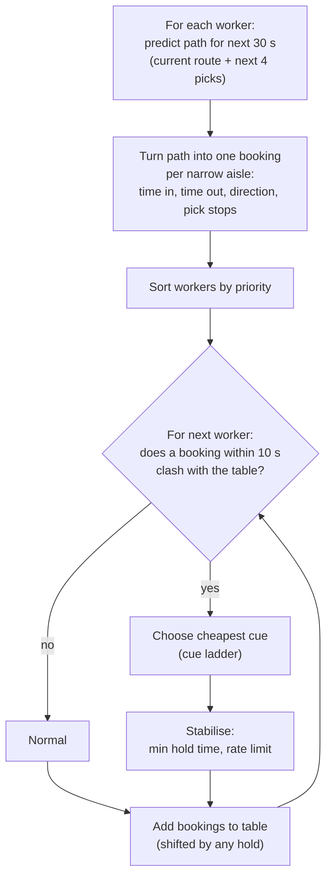

# Traffic engine

The **Density Matrix Engine** decides who uses each narrow aisle and when. It is inspired by
AMR **time-window routing** (also called time-expanded networks): every agent reserves a
slice of space for a slice of time, and the planner resolves overlaps before they happen.

Source: [`backend/swarm_server/engine.py`](https://github.com/rmaheedharan/swarm-amr/blob/main/backend/swarm_server/engine.py)
(kept in step with the simulation in the original demo).

## The floor as a graph

The site is a grid: parallel **pick aisles** joined by two **cross-aisles** (top and bottom).
Each aisle is a sequence of cells (default 1.2 m). Only aisles marked **narrow** are planned;
wide aisles and cross-aisles hold two or more people, so they are free.

```text
 cross-aisle (top)   ═══════════════════════════════════
                      ║      ║      ║      ║      ║
 aisle                A0     A1*    A2*    A3     A4       * = narrow
                      ║      ║      ║      ║      ║
 cross-aisle (bottom) ═══════════════════════════════════
                                                  depot ▣
```

## One engine tick (every second)



### Bookings and clashes

A **booking** is one worker's use of one narrow aisle: `start`, `end`, the lowest and highest
cell walked, the **direction** (+1 up, −1 down, 0 = in and back out the same end) and the
cells where they stop to pick.

Two bookings in the same aisle **clash** when their times overlap (with a 1 s margin) **and**:

- they go in **opposite directions**, or either turns around inside → **head-on**, or
- one stops to pick inside the stretch the other walks through → **behind**.

Walking behind someone in the same direction, without a stop in between, is fine.

### Priority

Workers are booked in priority order. A higher score books first and keeps its plan.

```python
score  = 100 if already inside the aisle      # never turn someone back
score += 200 if ignoring cues                 # plan around people who do not follow cues
score += 0.5 * recent_wait                    # fairness: who waited most goes first
score -= 0.1 * (first_booking_start - now)    # who arrives earlier goes first
```

### The cue ladder

For the first clash, the engine computes the **delay** the worker would suffer, then picks
the cheapest action that fixes it:

| Delay or case | Cue | What the worker feels |
| --- | --- | --- |
| ≤ 2 s | none | People adjust by themselves. |
| ≤ 4 s | **Warning** (slow down) | 2 short buzzes, amber banner |
| Another aisle is at least 5 s cheaper than waiting | **Reroute** | 3 short buzzes, purple banner |
| The blocked aisle is the next pick, and doing a later pick first saves at least 5 s | **Resequence** | The next pick changes (counted as a silent reorder) |
| ≤ 15 s | **Hold** at the aisle entrance | 1 long buzz, blue banner with countdown |
| > 15 s | none | Too long to wait; people sort it out. |
| Hold ends | **Go** | 1 short buzz, green banner |

"Behind" clashes only trigger Resequence, because waiting behind a picker costs the same as
waiting at the aisle mouth.

```text
decide(worker, clash):
    if no clash:                       return NORMAL
    delay = other.end + MARGIN - mine.start
    if clash.kind == behind:           return RESEQUENCE if it saves >= 5 s else NORMAL
    if delay <= 2:                     return NORMAL
    if delay <= 4:                     return WARNING
    if aisle is only on the way:
        alt = shortest path avoiding aisle
        if extra(alt) + 5 <= delay:    return REROUTE(alt)
    elif aisle holds the next pick:
        if a swap saves >= 5 s:        return RESEQUENCE(swap)
    if delay > HOLD_MAX (15 s):        return NORMAL
    return HOLD(until other.end + MARGIN)
```

### Stability rules (low cognitive load)

| Rule | Value | Why |
| --- | --- | --- |
| Act window | 10 s | Clashes further away often solve themselves. |
| Prediction horizon | 30 s | Enough to see the next aisle and the one after. |
| Minimum cue time | 8 s | A Warning or Hold is not flipped to something else right away. |
| Warning rate limit | 15 s | No new Warning within 15 s of the last cue. |
| Ignore detection | 5 s | A worker who does not follow a cue gets top priority; the plan bends around them. |
| Pick postponement | at most 2 | The same pick is never pushed back forever. |
| Cue re-send | every 4 s | Refreshes the expiry on the phone; a lost message is repaired. |

### Ghost workers

To test with one phone, the server can add **ghosts**: simulated workers that walk demo pick
lists on the same grid and obey cues perfectly. They create real traffic for the live phones.
Change the number on the dashboard or with `GHOSTS=5`.

## Why the hold limit is 15 s

The simulation compared hold limits (5 pickers with carts, simulation only):

| Max hold | Congestion incidents / h | Average delay per trip (s) | Cues felt / worker / h |
| --- | --- | --- | --- |
| Engine off | 138.3 | 2.5 | 0 |
| 6 s | 100.0 | 2.2 | 8.9 |
| 10 s | 98.1 | 2.3 | 16.5 |
| **15 s** | **85.6** | **2.3** | **20.9** |
| 30 s | 81.3 | 2.6 | 33.6 |
| No limit | 65.7 | 3.0 | 34.9 |

15 s gives most of the jam reduction while the average delay stays no worse than without the
engine. Longer holds cut more jams but make trips slower and double the cues. See
[Results and limits](results.md).
