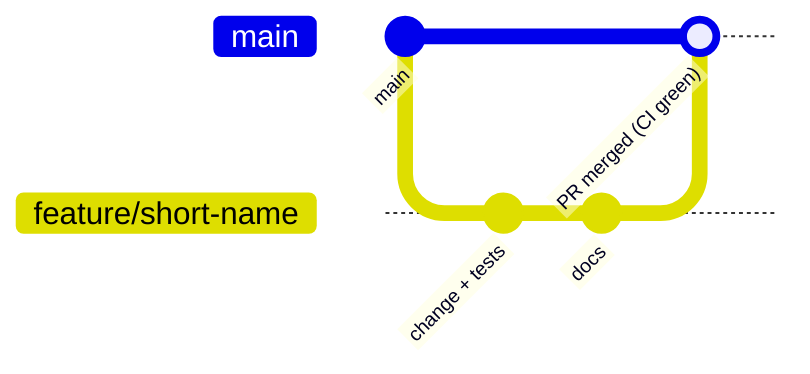

# Contributing

Contributions are welcome: bug reports, field test results, docs, and code.

## Ways to help

| Contribution | How |
| --- | --- |
| **Report a bug** | Open an [issue](https://github.com/rmaheedharan/swarm-amr/issues) with device model, Android/macOS version, app version, what you did, what you expected, and a screenshot or log. |
| **Share floor results** | Open an issue with the accuracy CSV summary (see [Reporting results](../guide/accuracy-test.md#reporting-results)). Remove anything private from the site file first. |
| **Improve docs** | Every page has an edit (pencil) button at the top that opens the file on GitHub. |
| **Fix or add code** | Follow the workflow below. |

## Workflow

1. **Fork** the repository (or create a branch if you have write access).
2. **Clone** and set up your machine: [Development setup](setup.md).
3. **Branch** from `main`: `git checkout -b feature/short-name`.
4. **Change** code and add or update tests. Keep positioning maths in `core/`.
5. **Run checks** locally: [Testing](testing.md).
6. **Commit** with a short, imperative message: `Add zone names to open-floor sites`.
7. **Push** and open a **pull request** against `main`. Describe what changed, why, and how
   you tested it. Add screenshots for UI changes.
8. CI must pass (Android, Backend, Mac, Docs). A maintainer reviews and merges.

## Rules of the project

- **Units:** metres and seconds, in the site frame (origin at a building corner, x across the
  aisles, y along them).
- **Keep maths in `core/`.** Android code stays thin; the JVM tests catch most bugs.
- **Change contracts together.** The site file, MQTT messages and fingerprint matcher have
  copies in Kotlin, Python and Swift. See [Implementation > Contracts](../implementation/index.md#contracts-between-parts).
- **Honest numbers.** Never claim accuracy that was not measured on a real floor. Label
  simulation results as simulation.
- **Simple words in the UI.** Workers and site staff are not developers. Prefer "Wait 6 s"
  to "Hold directive active".
- **No new permissions or dependencies** without a reason in the pull request.

## Licence

The project is licensed under the [Apache License 2.0](https://github.com/rmaheedharan/swarm-amr/blob/main/LICENSE).
By contributing, you agree that your contribution is licensed under the same terms.
