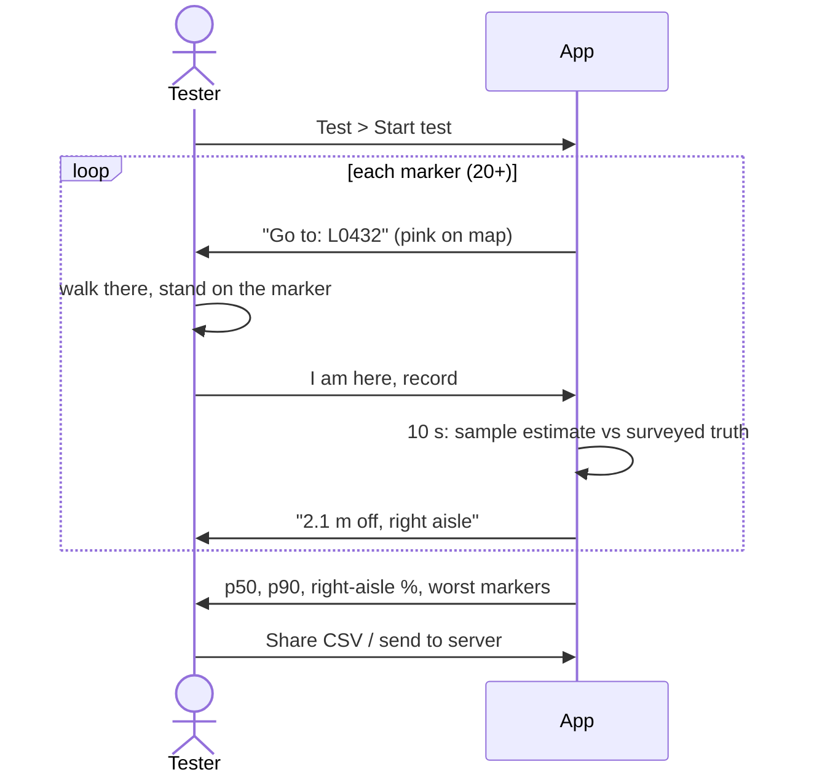

# Accuracy test

The accuracy test answers one question: **how close is the app's position to the truth, on
this floor, with this device?**

## How it works



The truth is the marker's surveyed position. A QR scan during the test only identifies the
marker; it does **not** reset the position, so the estimate stays independent of the truth.

## Procedure

1. Walk around for a minute so the filter settles.
2. **Test > Start test**.
3. Walk to the marker on the card, stand on it, tap **I am here, record**, stand still 10 s.
4. Cover at least **20 markers** in at least **3 aisles**.
5. Do a second round in a different order.
6. Share the CSV (share button) or **⋮ > Send results to server**.

## Metrics

| Metric (on screen) | Definition |
| --- | --- |
| **Half of readings within** | Median (p50) of the horizontal error in metres. |
| **9 of 10 readings within** | 90th percentile (p90) error, nearest-rank method. |
| **Right aisle** | Share of samples where the estimated aisle (or cross-aisle / zone) equals the marker's. |
| **Good enough for traffic cues** | Right aisle ≥ 95% **and** p90 ≤ 2 m. |
| **By marker, worst first** | Where to record Wi-Fi again or add markers. |

## CSV and report

The CSV has one row per sample:

```text
time_ms,marker,truth_x,truth_y,est_x,est_y,error_m,source,aps_used,sigma_m,truth_aisle,est_aisle,aisle_ok,device
```

`source` is `RTT`, `FINGERPRINT`, `RSSI_CENTROID` or `QR`. The Mac app writes the same columns.

```bash
python3 tools/accuracy_report.py accuracy.csv
```

prints the overall p50, p90 and correct-aisle %, a PASS / NOT YET verdict against the
target, tables by position source, by phone and by marker, and the 5 worst markers. Several
CSV files can be passed at once.

## Reporting results

When you share numbers, always include:

- site, date, device model, Android version,
- method in use (RTT or fingerprint) and how the Wi-Fi was recorded,
- number of markers and samples,
- p50, p90, right-aisle %.

Never report simulation numbers as floor accuracy.
