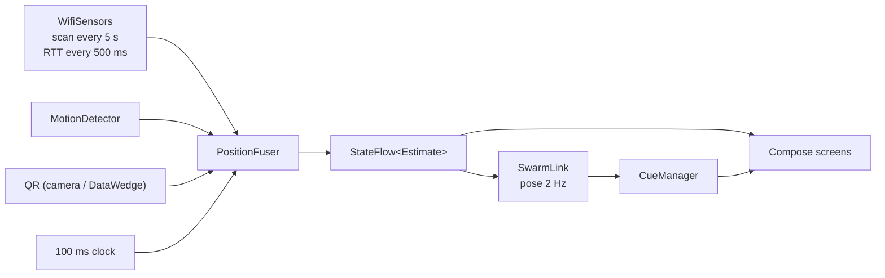

# Android app

| | |
| --- | --- |
| Package | `com.swarmamr.app` |
| Min / target SDK | 28 (Android 9) / 35 |
| UI | Jetpack Compose, Material 3 |
| Libraries | Paho MQTT 1.2.5, ZXing Android Embedded, kotlinx.serialization, coroutines |
| Tested on | Zebra TC5x, modern Android phones |

Android 9 is the minimum because that is where the Wi-Fi RTT API (`WifiRttManager`) arrived.

## Structure

```text
app/src/main/kotlin/com/swarmamr/app/
├── MainActivity.kt         Activity, permissions, DataWedge profile + receiver
├── SwarmApp.kt             Application: creates the Runtime once
├── Runtime.kt              Long-lived engine: sensors → PositionFuser → UI / MQTT
├── FieldTools.kt           Recording, walk-and-record, accuracy sampling helpers
├── data/
│   ├── Settings.kt         SharedPreferences-backed settings (server, scan rate, filters…)
│   └── SiteRepository.kt   Site file load / save / share / server sync
├── sensing/
│   ├── WifiSensors.kt      Wi-Fi scans (RSSI) and RTT ranging loops
│   ├── MotionDetector.kt   Accelerometer: standing or walking
│   └── PositioningService.kt  Foreground service, keeps positioning alive with screen off
├── swarm/
│   ├── SwarmLink.kt        MQTT client: pose out, directives + heartbeat in, Last Will
│   └── CueManager.kt       Cue state machine: banner, vibration pattern, chime, expiry
└── ui/                     Compose screens (Live, Set up, Test, Settings, onboarding…)
```

## Runtime loop

`Runtime` owns one `PositionFuser` and wires everything with coroutines:



- **`WifiSensors`** calls `WifiManager.startScan()` on an interval and reads the results from
  the broadcast. If Android refuses (throttling), it still reads cached results and counts
  the refusals, which drives the yellow warning. If the phone has `FEATURE_WIFI_RTT`, a second
  loop ranges to known RTT-capable APs.
- **`PositioningService`** is a foreground service with a notification so positioning keeps
  running when the screen is off.
- **`SwarmLink`** uses Paho with automatic reconnect (1 s up to 128 s back-off), a retained
  `status` message and a **Last Will** that marks the device offline.

## Cues: banner, vibration, sound

`CueManager` turns directives into what the worker feels. Each state has its own vibration
waveform (milliseconds: off, on, off, on…) and a short tone from `ToneGenerator`.

| State | Banner | Vibration pattern |
| --- | --- | --- |
| Normal | none | none |
| Warning | amber, "Slow down" | `0, 80, 120, 80` (2 short) |
| Hold | blue, "Wait N s" | `0, 500` (1 long) |
| Go | green, "Go" | `0, 150` (1 short) |
| Reroute | purple, "Take another way" | `0, 80, 80, 80, 80, 80` (3 short) |
| Resequence | purple, "Next pick changed" | `0, 80, 80, 80, 80, 80` (3 short) |
| Offline | grey, "No traffic info" | `0, 60` (tiny) |

A cue is dropped after its `expiresMs`. With no heartbeat for 5 s, the state becomes
**Offline**. **Settings > Practise the alerts** plays each one so workers can learn them.

## Zebra integration

- **DataWedge.** On start the app sends `com.symbol.datawedge.api.SET_CONFIG` to create a
  `SwarmAMR` profile (if it does not exist) with **intent output** to action
  `com.swarmamr.app.SCAN` and keystroke output off. A `BroadcastReceiver` in `MainActivity`
  delivers scanned codes to the current screen. On non-Zebra phones the camera scanner is used.
- **No EMDK dependency.** Everything uses standard Android APIs, so the same APK runs on Zebra
  and consumer phones. Position comes from the app's own Wi-Fi engine, not from Android
  Location Services (Location permission is still required by Android to read Wi-Fi scans).

## Screens

| Tab | Purpose |
| --- | --- |
| **Live** | Full-screen map with your dot, uncertainty, cue banner, next pick. Pinch, drag, follow-me. Traffic demo switch and details. |
| **Set up** | Checklist: floor plan (grid or picture with scale), markers, access points, Wi-Fi recording (stand, walk, guided), coverage layer. |
| **Test** | Accuracy test: guided walk to markers, "I am here", live p50/p90/correct-aisle, worst markers, CSV share and upload. |
| **Settings** | Server, broker, site id, device name, scan rate, AP filter, sound/vibration, practise alerts. |

## Permissions

| Permission | Why |
| --- | --- |
| `ACCESS_FINE_LOCATION` | Android requires it to return Wi-Fi scan results and for RTT. GPS is not used. |
| `ACCESS_WIFI_STATE`, `CHANGE_WIFI_STATE` | Start scans, read results. |
| `NEARBY_WIFI_DEVICES` (Android 13+) | RTT ranging. |
| `CAMERA` | QR scanning on phones without a hardware scanner. |
| `INTERNET` | MQTT and HTTP to the server. |
| `FOREGROUND_SERVICE`, `POST_NOTIFICATIONS`, `WAKE_LOCK` | Keep positioning alive with the screen off. |
| `VIBRATE` | Haptic cues. |

## Build

```bash
./gradlew :app:assembleDebug            # needs the Android SDK
./gradlew :core:test :app:testDebugUnitTest :app:lintDebug
```

CI builds a signed release APK on every push to `main` and attaches it to a GitHub Release
on every `v*` tag. See [Releases](../contributing/releases.md).
