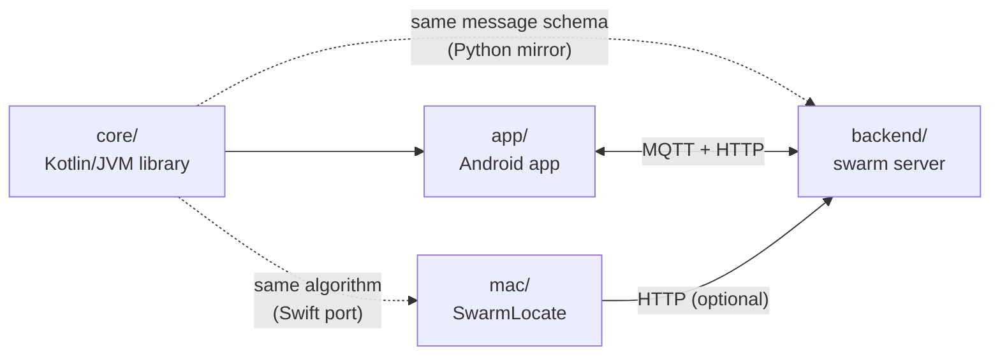

# Implementation

The code is one repository with four parts. Positioning maths lives in one place (`core/`)
and is shared by the Android app; the Mac app has a small Swift port of the matcher that must
stay in step with it.

| Part | Language | Read |
| --- | --- | --- |
| `core/` | Kotlin (JVM, no Android) | [Shared core library](core.md) |
| `app/` | Kotlin, Jetpack Compose | [Android app](android.md) |
| `mac/` | Swift, SwiftUI, CoreWLAN | [Mac app](mac.md) |
| `backend/` | Python 3.12, FastAPI, paho-mqtt | [Backend](backend.md) |

## Contracts between parts

Three things are shared across languages. When you change one, change all copies in the same
pull request.

| Contract | Kotlin | Other copies |
| --- | --- | --- |
| Site file (JSON) | `core/.../Site.kt` | `backend/swarm_server/site.py`, `mac/Sources/LocateCore/Site.swift` |
| MQTT messages | `core/.../Protocol.kt` | `backend/swarm_server/protocol.py` |
| Fingerprint matching and AP filter | `core/.../RssiPositioning.kt`, `Site.kt` | `mac/Sources/LocateCore/Matcher.swift`; AP filter also in `backend/swarm_server/site.py` |

Formats: [Site file](../site-file.md), [MQTT protocol](../reference/mqtt.md).
