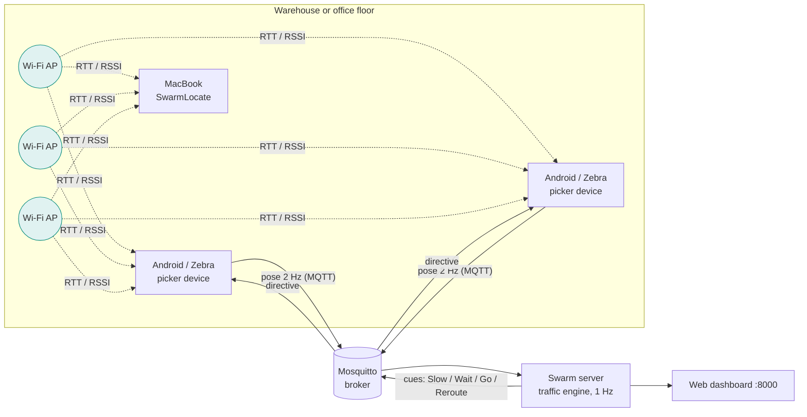

---
hide:
  - navigation
---

# Swarm AMR for Human Pickers

Traffic control ideas from warehouse robots, applied to people.
Phones and Zebra devices find their position from <strong>real Wi-Fi</strong>, a small server
plans who uses each narrow aisle, and the picker gets a simple cue: <em>Slow, Wait, Go,
Take another way</em>.

[Install the apps](guide/install.md){ .md-button .md-button--primary }
[How it works](concepts/index.md){ .md-button }
[Contribute](contributing/index.md){ .md-button }

---

## What is in the box

-   :material-cellphone-wireless:{ .lg .middle } **Android app**

    ---

    For Zebra TC5x and any Android 9+ phone. Finds the worker's position from Wi-Fi RTT or
    Wi-Fi fingerprints, shows the floor map, plays traffic cues, and runs the accuracy test.

    [:octicons-arrow-right-24: Android app](implementation/android.md)

-   :material-laptop:{ .lg .middle } **Mac app: SwarmLocate**

    ---

    Shows where a MacBook is on the same floor plan, using the Wi-Fi recordings made with the
    phone. Works without the server.

    [:octicons-arrow-right-24: Mac app](implementation/mac.md)

-   :material-server-network:{ .lg .middle } **Backend**

    ---

    Mosquitto MQTT broker, the Python traffic engine and a live dashboard. Starts with one
    command: `docker compose up`.

    [:octicons-arrow-right-24: Backend](implementation/backend.md)

-   :material-target:{ .lg .middle } **Accuracy test**

    ---

    Walk to surveyed markers, tap *I am here*, and get median error, 90th percentile error
    and correct-aisle rate. Exports CSV.

    [:octicons-arrow-right-24: Accuracy test](guide/accuracy-test.md)

## How it fits together

1. **Sense.** Each device measures Wi-Fi: distance to access points (RTT) where supported,
   otherwise signal strength compared to recordings (fingerprints). QR codes at aisle ends
   reset the position.
2. **Share.** The phone sends its smoothed position twice a second over MQTT.
3. **Plan.** Once a second, the server predicts where every worker will be in the next 30
   seconds and books each narrow aisle like a meeting room.
4. **Cue.** When two bookings clash, the server sends the cheapest fix: slow down, wait, go,
   take another aisle, or do another pick first. The phone shows a coloured banner, vibrates
   and plays a chime.

## Project status

This is a **proof of concept**. It is built to answer two questions on a real floor:

- Is Wi-Fi positioning good enough to tell which aisle a person is in?
- Do simple cues reduce aisle jams without making pick trips slower?

!!! note "Honest numbers"
    Traffic results so far come from a **simulation** and are always labelled as such.
    Position accuracy is only reported from the [accuracy test](guide/accuracy-test.md) on a
    real floor. See [Results and limits](concepts/results.md).

## Quick links

| I want to... | Go to |
| --- | --- |
| Install the Android app | [Install > Android](guide/install.md#android-app) |
| Install the Mac app | [Install > Mac](guide/install.md#mac-app-swarmlocate) |
| Run the server | [Install > Server](guide/install.md#server-backend) |
| Set up a site and test accuracy | [Field guide](field-guide.md) |
| Understand the maths | [Indoor positioning](concepts/positioning.md), [Traffic engine](concepts/traffic-engine.md) |
| Build from source and send a pull request | [Contributing](contributing/index.md) |
